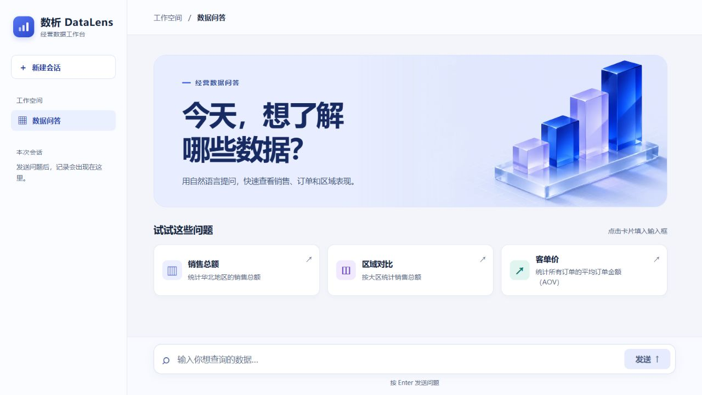
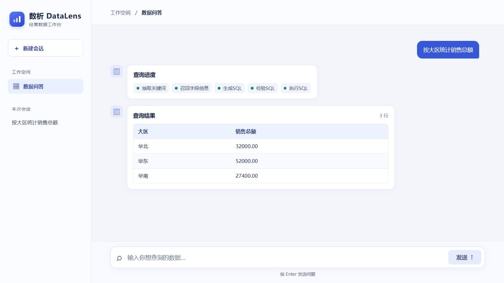
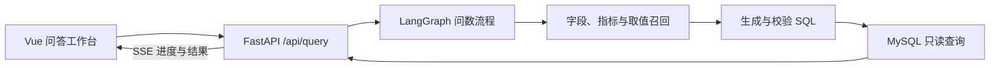

# 数析 DataLens

基于 LangGraph 的自然语言数据分析工作台。用中文提出销售、订单或区域问题，系统检索业务元数据和指标，生成并校验只读 SQL，边执行边在浏览器中展示进度与结果。





截图中的查询金额为模拟数据。仓库附带的教学数据用于本地体验，客户名称以示例编号展示。

## 功能亮点

- **自然语言转 SQL。** LangGraph 并行召回字段、指标和字段取值，利用 Qdrant 的语义检索及 Elasticsearch 的文本匹配补充上下文。
- **SQL 校验与纠错。** SQLGlot 分析语句结构，MySQL 执行前用 `EXPLAIN` 检查，校验失败时最多执行两轮模型纠错。执行层还会检查待执行 SQL 是否为已经校验通过的版本。
- **流式问数体验。** FastAPI 通过 SSE 发送进度和结果。Vue 前端展示执行步骤、结果表格、空结果、截断和错误提示。
- **请求隔离与追踪。** 共享客户端由应用生命周期管理，查询使用单独的会话，服务端生成请求编号供日志排查。



## Windows 本地运行

需要 Python 3.12、uv、Node.js 22.12+、Docker Desktop，以及可用的阿里云百炼 API Key。后端默认配置使用百炼 OpenAI 兼容接口，真实问数会发送问题及相关业务上下文给所配置的模型服务。请使用适合发送给该服务的数据。

### 首次安装

在项目根目录运行：

```powershell
uv sync --locked --python 3.12
Push-Location data-agent-fronted
npm ci
Pop-Location
```

准备两个运行文件，路径均相对于项目根目录：

- 从 [BAAI 模型仓库](https://huggingface.co/BAAI/bge-large-zh-v1.5) 下载完整的 `bge-large-zh-v1.5` 模型，保存到 `docker/embedding/bge-large-zh-v1.5/`。目录中应包含实际的模型权重和 tokenizer 配置。
- 从 [INFINI Labs 的 IK 插件下载页](https://release.infinilabs.com/) 获取与 Elasticsearch **8.19.10** 对应的插件包，保存为 `docker/elasticsearch/plugins/elasticsearch-analysis-ik-8.19.10.zip`。

在 Windows 用户环境变量中设置 `OPENAI_API_KEY`、`DATALENS_MYSQL_PASSWORD` 和 `DATALENS_MYSQL_ROOT_PASSWORD`。两项数据库密码可自行设置。应用使用 `DATALENS_MYSQL_PASSWORD` 连接 Compose 首次初始化的应用账号。建议使用随机字母和数字组成的密码。设置后打开新的 PowerShell：

```powershell
docker compose -f docker/docker-compose.yaml up -d mysql qdrant elasticsearch embedding
curl.exe --noproxy "*" -f http://127.0.0.1:8081/health
```

待 Embedding 健康检查成功、MySQL 初始化完成后，构建元数据和检索索引：

```powershell
.\.venv\Scripts\python.exe -m app.scripts.build_meta_knowledge --conf conf/meta_config.yaml
```

数据库初始化脚本在 MySQL 数据卷首次创建时运行。已有容器继续使用初始化时设置的密码。应用可通过被 Git 忽略的 `conf/app_config.local.yaml` 覆盖本机连接配置。

### 日常启动

双击根目录的 **`start.cmd`**，或在 PowerShell 运行 `.\start.cmd`。脚本启动依赖和前后端，检查就绪后打开 [问答页面](http://127.0.0.1:5173/)。用完在启动窗口按 **Enter** 停止前后端。启动日志位于 `.local/startup/`。API 文档可在运行时访问 [Swagger UI](http://127.0.0.1:8000/docs)。

可以试问「按大区统计销售总额」或「统计所有订单的平均订单金额（AOV）」。

## 验证

前端测试覆盖 HTTP 错误、响应类型和 SSE 读取。后端离线测试覆盖检索流程、SQL 校验及纠错、API 和流式资源清理。以下数据库密码占位值仅用于离线测试：

```powershell
$env:DATALENS_MYSQL_PASSWORD = 'offline-test'
.\.venv\Scripts\python.exe -m unittest discover -s tests -p "test_*.py"
npm --prefix data-agent-fronted test
npm --prefix data-agent-fronted run build
```

如果容器和索引已就绪并配置了有效的模型密钥，可运行单个真实联调用例。脚本用独立的基准 SQL 核对问数金额，并将报告保存在本机：

```powershell
.\.venv\Scripts\python.exe -m app.scripts.check_query_api --case region-total
```

## 项目结构

| 路径 | 内容 |
| --- | --- |
| `app/agent/` | LangGraph 工作流、召回与 SQL 节点 |
| `app/api/`、`app/services/` | HTTP/SSE 接口、请求依赖与问数服务 |
| `data-agent-fronted/` | Vue 问答界面 |
| `conf/`、`docker/` | 配置、依赖容器与教学数据 |
| `tests/`、`docs/` | 测试、开发说明与演示截图 |

本项目以尚硅谷自然语言问数课程为基础，包含后续的接口健壮性、可观测性和前端展示改进。第三方模型及插件请遵循各自上游条款。
